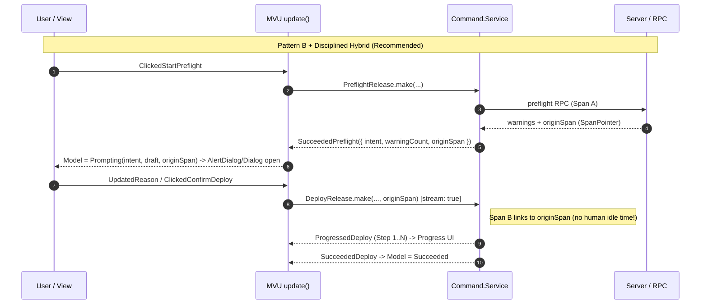

# Command & Workflow Architecture for `@effect/ui` + `@effect/ui-kit`

**Status:** Architecture & Trade-Off RFC  
**Target stack:** `effect@4.1.6`, `@effect/ui@7bff56b`, `@effect/ui-kit@7bff56b`  
**Related docs:** [`complex-forms.md`](./complex-forms.md) · [`i18n-proposal.md`](./i18n-proposal.md) · [`../src/design/queryResult.ts`](../src/design/queryResult.ts)

---

## Executive Summary & Architectural Verdict

This RFC evaluates how to bring the strongest ergonomics of `effect-app/packages/vue`'s `Commander` — single-trace observability, typed error formatting, progress/status reporting without noisy toasts, and mid-flow confirmation or input dialogs — into `@effect/ui` and `@effect/ui-kit`.

**Verdict:**

1. **Reject Pattern A** (one long-lived `stream: true` `Command.Service` that suspends mid-generator on a `Deferred` confirmation prompt, drives a `WaitingGate`, and pushes out-of-band progress/toasts). Pattern A breaks `@effect/ui`'s core invariants around `optimistic`/`invalidates`/`afterRefetch`, `h.isRunning`, `Story`/`Scene`/`Story.explore`, `Story.fromLog` replay, history `restore`, `ToastProvider` ownership, and OTel span latency semantics.
2. **Adopt Pattern B (Pure MVU + Atomic Commands) as the default, paired with a Disciplined Hybrid for cross-boundary prompts and multi-stage runtime streams:**
   - **Workflow state, confirmation gates, and step transitions** live explicitly in the component `Model` (via a lightweight `CommandFlow` schema/helper or a dedicated child `Wizard` component) and controlled `@effect/ui-kit` `AlertDialog` / `Dialog` primitives.
   - **Commands remain atomic per execution phase** (`Preflight` -> user dialog -> `Execute`). Side effects only run inside `Command.Service` bodies after `update` approves the transition.
   - **Scoped `Deferred` bridges** (`SubscriptionRef<Option<Deferred<Answer>>>` + `Effect.acquireUseRelease`, as in Tim Smart's `bunnings-lite` `StoreSearchPrompt`) are reserved strictly for singleton shell drawers outside an inert page, and the prompt Command returns the user's answer to `update` rather than chaining mutations behind the caller's back.
   - **`stream: true` Commands** are reserved strictly for genuine multi-phase backend/runtime progress after user confirmation (such as streaming job steps or `PendingJoin`), rendered via inline `@effect/ui-kit` `Progress` and `CommandResult` panels — with `ToastProvider` strictly opt-in from `update` via `$.send`.
   - **OTel trace correlation across human pauses** uses a Schema-serializable `SpanPointer` (`{ traceId, spanId }`) stored in `Model` and attached to downstream execution spans via `span.addLinks(...)` + `Effect.linkSpans(...)` (zero human think-time inflation on execution spans).

---

## 1. Empirical Findings

### 1.1 How `effect-app/packages/vue` `Commander` Works

Inspection of `effect-app/packages/vue/src/commander.ts`, `confirm.ts`, `packages/effect-app/src/waitingGate.ts`, and `packages/effect-app/src/withToast.ts` shows how Vue-era `Commander` achieves its single-generator ergonomics:

- **Single root span + dual stack trace capture** (`commander.ts#L2419-L2473`): `handle(arg)` captures both definition-site and call-site stack traces and wraps execution in `Effect.withSpan(exec(...), id, { captureStackTrace, attributes: { input, state, action, label, id, i18nKey } })`.
- **Two-tier busy state via `WaitingGate`** (`waitingGate.ts#L31-L90`, `commander.ts#L2214-L2247`): `blocked` stays `true` for the whole run (plus shared `blockKey` counters in a module-level Vue `ref`), while `waiting` (`running && quiet === 0`) drops when `suspendWaiting` increments gate depth. `WithToast` (`withToast.ts#L157-L199`) binds to `WaitingGate` to disarm the 1-second-delayed waiting toast while parked on user input, then re-arms it when work resumes.
- **Imperative mid-flight confirmation** (`confirm.ts#L7-L32`, `commander.ts#L1850-L1865`): `Confirm.confirmOrInterrupt` runs `window.confirm(...)` (or a prompt service) mid-generator and aborts the remainder of the Command via `Effect.interrupt`.
- **Imperative progress & toast mutation** (`commander.ts#L127-L131`, `L1808-L1835`, `L2085-L2164`): `CommandProgress` mutates a Vue `ref<Progress | undefined>` inside `Stream.tap`; `withDefaultToast` / `withDefaultToastStream` reads `Effect.currentSpan` to attach `requestId` (`traceId`) and appends `\nTrace: ${span.traceId}\nSpan: ${span.spanId}` to failure toasts (`commander.ts#L2110-L2116`), delegating typed errors (`SupportedErrors`, `SchemaError`) to `CommanderErrorRenderers` (`commander.ts#L1685-L1738`).
- **Why this relies on Vue's mutable runtime:** A `Commander` instance assumes out-of-band mutable `ref` state (`result`, `progress`, `quiet`, `waitState`), non-serializable suspended fiber continuations across UI pauses, and imperative toast pushing — none of which survive `@effect/ui`'s pure `update`, `Story.fromLog`, or `history.state` serialization.

### 1.2 `@effect/ui@7bff56b` & `@effect/ui-kit@7bff56b` Invariants

1. **Command & Query root spans already parent child spans** (`Effect-TS/ui#480` `402f7cb`, closing `#469`):
   - `internal/commandRun.ts#L207-L241` opens `Effect.useSpan(command.name, { attributes: { path: inst.path, mode: command.mode } }, ...)` and provides the active span to `command.work` via `Effect.provideService(body, Tracer.ParentSpan, span)`.
   - In `effect@4.1.6` (`internal/effect.js#L590-L593`, `L2928-L2946`), `fiber.currentSpanLocal` resolves `Tracer.ParentSpan`, so `Effect.currentSpan`, `Effect.annotateCurrentSpan`, `span.addLinks(...)`, and nested `RpcClient` spans automatically attach under the Command run's root span. `Query.ts#L4912-L4921` applies the same pattern (`Effect.useSpan(def.name, { attributes: { trigger } }, ...)`).
2. **Built-in Command concurrency, grouping, and cache lifecycle** (`Command.ts#L176`, `L335-L350`, `L1409-L1410`, `L1968-L2215`):
   - `mode: "concurrent" | "switch" | "queue"` + `group: ["id"]` + `h.isRunning(Cmd, group?)` + `Command.interrupt(Cmd, group?)` replace `commander`'s `waitKey`/`blockKey`/fiber management cleanly, and `Story.fromLog` reconstructs `h.isRunning` accurately from `CommandStarted` / `CommandEnded` / `CommandInterrupted` (`internal/replay.ts#L385-L388`).
   - `optimistic` patches apply immediately on `issue` (`commandRun.ts#L550`), `invalidates` run when the Command fiber exits (`Command.ts#L337`), `writes` is disallowed on `stream: true` (`Command.ts#L1409-L1410`), and `Command.afterRefetch(budget)` (`commandRun.ts#L328-L452`, `CommandAwaiting`) holds completion delivery on `"Effect"` Commands until invalidated active queries refetch (the native `@effect/ui` counterpart to `effect-app`'s `invalidateAndAwait` in `mutate.ts`).
3. **Pure `update` & replay invariants (`Story.fromLog`, `Story.explore`, `restore`)**:
   - `Story.fromLog` (`internal/replay.ts#L438-L475`) replays logged messages through `component.update` without executing Command Effects and asserts exact structural equivalence on `{ model, events, commands, lists, sends }`. Any hidden multi-step state in a suspended fiber or non-deterministic `Date.now()` / `Math.random()` inside `update` breaks replay.
   - History `restore` (`AGENTS.md#L898-L946`, `internal/stateRestore.ts#L371-L403`) restores saved `Model` + `queries` and runs **only `init`'s Commands, never `update`'s Commands**. In-flight `Running` flags must reset via `restore: (model) => ...`, and any workflow suspended on a `Deferred` loses its continuation across Back/Forward or page reload.
   - Every Command fiber belongs to the issuing instance and is interrupted on unmount (`Command.ts#L1314-L1317`); work outliving a route must be delegated via `$.send` to a layout/shell owner.
4. **Upstream `@effect/ui-kit` component ownership**:
   - `AlertDialog.ts#L5-L11` and `Dialog.ts#L5-L10`: The consumer always owns `open: boolean` in `Model` and handles `RequestedOpen` / `RequestedClose` / `Settled`.
   - `Toast.ts#L114-L120`: Outside-tree toast pushing is explicitly unsupported; Commands return messages to `update`, which calls `$.send(ToastProvider, { _tag: "RequestedAdd" | "RequestedUpdate" | "RequestedClose", ... })`. Importantly, `Component.ts#L543-L560` (`OwnStepRequirements` + `OptionalTargets`) drops `Shared.Of<typeof ToastProvider>` from a component's requirements whenever the component declares `reads: { toastProvider: { owner: ToastProvider, optional: true } }`.
   - `Progress.ts#L118-L123`: Pure controlled props (`value: number | null`, `min`, `max`, `valueText`) with SSR-safe inline indicator width and `data-indeterminate` / `data-progressing` / `data-complete`.

### 1.3 Tim Smart's `bunnings-lite` Reference Patterns

Inspection of `/home/patroza/pj/bunnings-lite` reveals three clear idiomatic boundaries:

1. **Pure MVU confirmation by default** (`src/sync/components/InviteDialog.ts#L57-L102`): `InviteDialog` holds `invite` + `open` in its `Model`, listens for invites via a `Subscription`, and issues `JoinSync.make()` only when `ClickedJoin` arrives in `update`.
2. **Scoped `Deferred` bridge only across a shell/modal boundary** (`src/stores/services/StoreSearchPrompt.ts#L19-L77`, `src/stores/components/StoreSelector.ts#L47-L105`, `src/Shell.ts#L181-L204`): Because `StoreSearch` is a singleton drawer in `Shell` outside an inert page, `StoreSearchPrompt` uses `SubscriptionRef<Option<Deferred<Answer>>>` + `Effect.acquireUseRelease` (`ask`, `asking`, `answer`). Crucially, `SearchAllStores` **only** awaits `prompt.ask` and returns `AnsweredStoreSearch({ store })` to `StoreSelector.update` — `StoreSelector.update` still owns the workflow decision to run `ChooseStore.make({ location })` (with `optimistic` + `invalidates`) as a separate atomic Command!
3. **Stream Command strictly for runtime phases** (`src/App.ts#L23-L135`, `src/sync/services/PendingJoin.ts#L31-L89`): `FinishJoin` (`stream: true`) streams `"Blocked" | "Finished"` while `indexedDB.deleteDatabase` waits on other tabs, updating `model.join` to render inline `role="status"` / `role="alert"` banners with zero toasts.
4. **OTel tracing** (`src/Tracing.ts#L6-L25`): `OtlpTracer.layer` exports Effect spans directly via OTLP.

### 1.4 Upstream `Effect-TS/ui` & `foldkit/foldkit` Findings

- **`Effect-TS/ui` examples**: `examples/interrupting-commands/src/Uploads.ts` uses keyed `Command.Service` (`group: ["uploadId"], mode: "switch"`) + `Command.interrupt` for cancellation; `examples/launch/src/prompt/AgentPrompts.ts` models transient command feedback inline (`Idle | Copied | Failed` + `sr-only` `role="status"` + timer Command) instead of toasts. `Effect-TS/ui#457` (slow phases) and `#497` (linking `Reactivity` keys to `Query.Service` / `Command.Service`) reinforce keeping runtime state observable and cache-aligned.
- **`foldkit/foldkit` examples & discussions**: `examples/state-machine` (`packages/foldkit/src/experimental/machine/machine.ts`) models multi-step flows as pure `TaggedUnion` states + transition tables (`to`, `when`, `otherwise`); `examples/interrupting-commands` models per-row cancellation via keyed Commands; Discussions `#736` (TEA ELS rules for `update` purity and Command discipline), `#726` (per-Command outcomes in DevTools/MCP), and `#1255` (Command catalog over MCP) all highlight why keeping every step's transition and Command intent as explicit MVU data is foundational to DevTools, testing, and AI-assisted inspection.

---

## 2. Architecture Comparison: Pattern A vs Pattern B vs Disciplined Hybrid

### Flow Comparison



### Trade-Off Matrix

| Dimension                                                     | Pattern A: Long-lived `stream: true` Command + `Deferred` + `WaitingGate`                                                                                | Pattern B: Pure MVU State Machine + Atomic Commands + Kit Dialogs                                                        | Disciplined Hybrid (Recommended): MVU + Atomic Commands + Scoped Bridge/Stream Only Where Justified                                                                            |
| :------------------------------------------------------------ | :------------------------------------------------------------------------------------------------------------------------------------------------------- | :----------------------------------------------------------------------------------------------------------------------- | :----------------------------------------------------------------------------------------------------------------------------------------------------------------------------- |
| **MVU / `update` purity**                                     | Breaks: workflow progression and confirmation branching hide inside an imperative Effect generator.                                                      | Pure: every transition is `(Model, Msg) -> Step`.                                                                        | Pure: `update` owns every decision; a bridge Command only returns `Answered*`.                                                                                                 |
| **OTel trace latency**                                        | **Broken by default:** root span stays open across unbounded human think-time, distorting p95/p99 latency and SLA alerts.                                | Clean: each execution phase is its own short-lived span correlated via `SpanLink` / `SpanPointer`.                       | Clean: preflight and execution spans record real work duration, linked via `SpanPointer`.                                                                                      |
| **Query cache (`optimistic`, `invalidates`, `afterRefetch`)** | Broken: `optimistic` applies before confirmation, `invalidates` fires only on final exit, `afterRefetch` cannot be used on `stream: true`.               | Exact: confirmation happens before `Execute` issues `optimistic`; `afterRefetch` works on `"Effect"` execution Commands. | Exact: `SearchAllStores` carries no mutation cache options; `ChooseStore` carries `optimistic` + `invalidates`.                                                                |
| **`h.isRunning` & `mode: "switch" \| "queue"`**               | Broken: `h.isRunning` stays `true` while dialog is open unless a secondary `WaitingGate` suppresses it; queued runs block behind user hesitation.        | Exact: `h.isRunning` reflects actual active async execution; `Prompting` is a distinct Model tag.                        | Exact: `preflighting` / `Prompting` / `Running` are explicit and non-overlapping.                                                                                              |
| **`Story`, `Scene`, `Story.explore`**                         | Degraded: `Story.explore` cannot enumerate confirmation/input paths cleanly without driving a fake `Deferred` service.                                   | First-class: every dialog branch, validation guard, and error path is explored as pure `(Model, Msg)` steps.             | First-class: prompt components (`StoreSearch`) and callers (`StoreSelector`) test independently in `Story`/`Scene`.                                                            |
| **DevTools Replay (`Story.fromLog`)**                         | Fragile: mid-Command `Deferred` resolution depends on external service synchronization rather than pure `Update` entries.                                | 100% deterministic: every state and issued Command replays verbatim from `MessageLog`.                                   | 100% deterministic: `Answered*` and `Progressed*` arrive as explicit logged messages.                                                                                          |
| **History `restore` & SSR**                                   | **Broken:** Back/Forward restores `Model` and re-runs `init` only; parked fibers are gone forever, leaving UI wedged unless cleared (losing step state). | Resilient: `restore` clears `Running` -> `Idle` while preserving draft/prompt inputs if desired.                         | Resilient: `CommandFlow.restore` resets transient `Running` and preserves safe draft context.                                                                                  |
| **Cross-tree singleton modals**                               | Uses service `Deferred` everywhere, even for simple local confirmations.                                                                                 | Local `AlertDialog` / `Dialog` in the component; `ModalProvider` (`shares`/`$.send`) for shared subtree modals.          | Local `AlertDialog`/`Dialog` by default; `ModalProvider` inside subtrees; Tim's `SubscriptionRef<Option<Deferred<T>>>` only for top-level Shell drawers (`StoreSearchPrompt`). |

---

## 3. OTel Tracing & Span Correlation Without Human Think-Time Inflation

### 3.1 Single-Command Work (Already Solved in `@effect/ui@7bff56b`)

Every `Command.Service` run (both single-shot `"Effect"` and `"Stream"`) opens one root span named after the Command key (`internal/commandRun.ts#L207-L241`) and provides it as `Tracer.ParentSpan`. All downstream RPC client spans (`RpcClient`) and server handlers (via W3C `traceparent` HTTP propagation) automatically appear as children of that single Command span.

### 3.2 Multi-Step Workflows Across Human Think-Time (`CommandTrace`)

When a workflow pauses for human input between two Commands (e.g., `PreflightRelease` -> `Dialog` -> `DeployRelease`), **do not** keep a root span open across the dialog. Instead:

1. **Capture a Schema-serializable `SpanPointer`** inside the originating Command's Effect (`Effect.currentSpan`) and return it in the Command's success/failure message. Never call `Effect.currentSpan` or `Date.now()` inside `update` — keep span metadata as explicit Message/Model data so `Story.fromLog` stays deterministic.
2. **Correlate downstream Commands using OTel `SpanLink` (Recommended Default):**
   - Look closely at `effect@4.1.6` (`internal/effect.js#L2857-L2881` vs `observability/OtlpTracer.js#L215-L219`, `L285-L294`): because `commandRun.ts` calls `Effect.useSpan` _before_ evaluating `command.work`, `Effect.linkSpans(...)` inside `command.work` adds links only to **child spans** created inside the Command body. To attach the link to **the Command run span itself**, call `currentSpan.addLinks([{ span: Tracer.externalSpan(origin), attributes }])` as well!
   - Annotate `workflow.origin_trace_id` and `workflow.origin_span_id` on the active Command span so log/trace search finds all phases by one `origin_trace_id` even in trace backends with limited `SpanLink` UI indexing.
3. **Alternative (`ExternalSpan` Parenting):** Wrap the inner work in `Effect.withSpan("phase.execute", { parent: Tracer.externalSpan(origin) })`. This groups preflight and post-confirm RPC spans into a single waterfall `traceId` with a visible human-think-time gap and zero duration inflation on the closed preflight span. Trade-off: `@effect/ui`'s outer `commandRun` span still belongs to the new trace, whereas `SpanLink` + `workflow.origin_trace_id` keeps `@effect/ui`'s outer Command span directly linked.
4. **Support Trace Reference on Inline Failures:** Store `failureSpan` / `originSpan` (`SpanPointer`) on the `Failed` state and show a muted `Ref <8-char-traceId>` badge in the inline error banner instead of dumping raw `Trace: ... / Span: ...` lines into toasts.

```ts
export const SpanPointer = Schema.Struct({
  traceId: Schema.String,
  spanId: Schema.String
})
export type SpanPointer = typeof SpanPointer.Type

export const captureSpanPointer: Effect.Effect<SpanPointer | null> = Effect.option(Effect.currentSpan).pipe(
  Effect.map(
    Option.match({
      onNone: () => null,
      onSome: (span) => ({ traceId: span.traceId, spanId: span.spanId })
    })
  )
)

export const captureCommandOutcome = Effect.fnUntraced(function* <A, E, R>(effect: Effect.Effect<A, E, R>) {
  const value = yield* effect
  const originSpan = yield* captureSpanPointer
  return { value, originSpan }
})

export const withOriginSpanLink =
  (origin: SpanPointer | null, relationship: string, extraAttributes?: Readonly<Record<string, unknown>> | undefined) =>
  <A, E, R>(effect: Effect.Effect<A, E, R>): Effect.Effect<A, E, R> => {
    if (origin === null) return effect
    const external = Tracer.externalSpan({ traceId: origin.traceId, spanId: origin.spanId })
    const linkAttrs: Record<string, unknown> = {
      "workflow.relationship": relationship,
      ...extraAttributes
    }
    return Effect.gen(function* () {
      const current = yield* Effect.option(Effect.currentSpan)
      if (Option.isSome(current)) {
        // Attach to the already-opened Command root span (exported on span.end)
        current.value.addLinks([{ span: external, attributes: linkAttrs }])
        current.value.attribute("workflow.origin_trace_id", origin.traceId)
        current.value.attribute("workflow.origin_span_id", origin.spanId)
      }
      // Also propagate link to any child spans opened inside `effect` (e.g. RpcClient)
      return yield* Effect.linkSpans(effect, external, linkAttrs)
    })
  }

export const withOriginSpanLinkStream =
  (origin: SpanPointer | null, relationship: string, extraAttributes?: Readonly<Record<string, unknown>> | undefined) =>
  <A, E, R>(stream: Stream.Stream<A, E, R>): Stream.Stream<A, E, R> =>
    origin === null
      ? stream
      : Stream.unwrap(withOriginSpanLink(origin, relationship, extraAttributes)(Effect.succeed(stream)))
```

_(Verified with `tsrs` + `vp lint` in spike against `effect@4.1.6`.)_

---

## 4. Inline Status, Progress & Structured Error UX (`CommandResult`)

Following [`src/design/queryResult.ts`](../src/design/queryResult.ts) and [`src/pages/OrderFormPage.ts`](../src/pages/OrderFormPage.ts), Command feedback should be **inline and contextual by default**, keeping `ToastProvider` strictly opt-in:

### 4.1 Failure Taxonomy

1. **Field-level validation errors** (e.g., `OrderValidationError`): Map into `SchemaForm.setServerErrors` + `HtmlCommand.focus(ErrorSummaryRef, () => Component.noop)` so offending fields highlight and auto-clear on edit.
2. **Domain failures** (`ApiError` or domain tagged errors): Render via `commandErrorBanner` (`role="alert"`) with a human-safe `describeCommandError` message, optional `Ref <traceId>` badge, and explicit `Dismiss` (or `Retry` when retryable).
3. **Transport failures** (`RpcClientError`): Render as retryable inline banner while **preserving draft / dialog edits** (never wipe user input on failure).
4. **Unexpected defects**: Never `catchAll` defects in Command bodies; let `@effect/ui` surface them to the parent's `fallback` boundary and report via OTLP/Observability.

### 4.2 Inline Progress & `Command.afterRefetch`

- **Single-shot Commands**: Use button `disabled` + label transition (`"Deploy release"` -> `"Deploying…"`) backed by `model.flow._tag === "Running"` or `h.isRunning(Cmd)`, plus a polite `role="status"` region when completed (`AgentPrompts.ts` style).
- **Multi-step `stream: true` Commands**: Render `commandProgressPanel` wrapping `@effect/ui-kit` `Progress` (`value: completed | null`, `max: total`) with an explicit `Cancel` button issuing `Command.interrupt(Cmd, group)`.
- **Cache settle synchronization**: When a mutation Command updates list/detail data read by a visible `Query.Service`, chain `Command.afterRefetch("2 seconds")` so the success state and newly refetched query render together in one frame without stale-data flicker.

### 4.3 Strictly Opt-In `ToastProvider` Choreography

Per `@effect/ui-kit/src/Toast.ts#L116-L119`, Commands never push toasts directly. When a page/action explicitly opts into toasts (for example, background saves across navigation):

1. Mount `ToastProvider` once near the shell/layout root (with a single normal child component inside its `view` closure so toast ticks never re-render the whole page unnecessarily — see `23_shared-state.ts#L108-L118`).
2. Components that want toast notifications without coupling to `ToastProvider` in unit `Story`/`Scene` tests declare:
   ```ts
   reads: { toastProvider: { owner: ToastProvider, optional: true } }
   ```
   Because `ToastProvider` is `optional: true` in `reads`, `Component.ts#L548-L560` drops `Shared.Of<typeof ToastProvider>` from the component's requirements (`R`), and any `$.send(ToastProvider, ...)` when no provider is mounted becomes a harmless `SendDropped` log entry.
3. Use deterministic domain IDs (`deploy:${releaseId}:${attempt}`) so `RequestedAdd` (`type: "loading"`) transitions smoothly into `RequestedUpdate` (`type: "success"` / `"error"` with `timeout`) or `RequestedClose` on cancel.

---

## 5. Reusable Ergonomics Without MVU Boilerplate (`CommandFlow`)

### 5.1 `makeCommandFlow` Helper

To get `effect-app`'s `Commander` ergonomics (`waiting`/`blocked`/progress/error/attempt tracking/safe reset) without sacrificing MVU purity or `Schema` serialization, `makeCommandFlow` packages the recurring state machine once:

```ts
export type CommandFlowState<Intent, Draft, Prog, Res, Err> =
  | { readonly _tag: "Idle" }
  | {
      readonly _tag: "Prompting"
      readonly intent: Intent
      readonly draft: Draft
      readonly originSpan: SpanPointer | null
    }
  | {
      readonly _tag: "Running"
      readonly intent: Intent
      readonly attempt: number
      readonly originSpan: SpanPointer | null
      readonly progress: Prog | null
    }
  | {
      readonly _tag: "Succeeded"
      readonly intent: Intent
      readonly result: Res
      readonly span: SpanPointer | null
    }
  | {
      readonly _tag: "Failed"
      readonly intent: Intent
      readonly draft: Draft | null
      readonly error: Err
      readonly attempt: number
      readonly originSpan: SpanPointer | null
      readonly failureSpan: SpanPointer | null
    }
```

Key properties verified under `tsrs` (`strict` + `exactOptionalPropertyTypes`) and `vp lint`:

- **Schema-serializable (`State`)**: Works directly inside `Html.component({ model: Schema.Struct({ flow: MyFlow.State }) })`, SSR `#state`, `MessageLog`, and `Story.fromLog`.
- **History `restore`-safe (`restore(state)`)**: Resets `Running` -> `Idle` automatically (and closes transient `Prompting` unless `preservePromptOnRestore: true`), ensuring Back/Forward navigation never leaves a dead spinner waiting for an unstarted Command.
- **Zero-cast pure transitions**: `openPrompt`, `updateDraft`, `cancelPrompt`, `start`, `startFromPrompt`, `progressed`, `succeeded`, `failed`, `cancelRunning` keep `update` handlers concise and deterministic.

### 5.2 Choosing the Right Abstraction Boundary

| Scenario                                                       | Recommended Mechanism                                                                                                                            | Why                                                                                                                    |
| :------------------------------------------------------------- | :----------------------------------------------------------------------------------------------------------------------------------------------- | :--------------------------------------------------------------------------------------------------------------------- |
| **Simple yes/no confirmation or 1–2 field prompt on one page** | `CommandFlow` + `@effect/ui-kit` `AlertDialog` / `Dialog` inside the page/card                                                                   | Minimal files; `AlertDialog` owns focus trap, Escape, `role="alertdialog"`, and `disablePointerDismissal`.             |
| **Multi-step wizard (3+ steps, step-local validation)**        | Encapsulated child `Wizard` component mounted conditionally (`model.wizardOpen && Wizard(h, ...)`) emitting `Finished` / `Cancelled`             | Keeps step-local fields out of parent `Model` and automatically resets on unmount (`27_state-ownership.ts#L100-L179`). |
| **Cross-subtree modal inside a shared layout**                 | `ModalProvider` with `shares` + `receives` + `$.send`                                                                                            | Pure MVU with compile-time ownership checks (`27_state-ownership.ts#L185-L278`).                                       |
| **Page behind an inert Shell drawer (`StoreSearch` style)**    | Singleton Shell service (`SubscriptionRef<Option<Deferred<Answer>>>` + `Effect.acquireUseRelease`) whose Command returns `Answered*` to `update` | Only place a `Deferred` crosses tree boundaries cleanly; mutations still issue from `update`.                          |
| **Work that must outlive route navigation**                    | Layout/Shell `BackgroundJobsProvider` (`shares` + `receives: ["RequestedStart*"]`) issuing the `Command.Service`                                 | Commands cancel when their issuing instance unmounts (`Command.ts#L1314-L1317`); Shell stays mounted.                  |

### 5.3 Side-by-Side Ergonomic Comparison

| Concern                           | `effect-app/vue` `Commander`                                    | `@effect/ui` + `CommandFlow` + `CommandResult`                                 |
| :-------------------------------- | :-------------------------------------------------------------- | :----------------------------------------------------------------------------- |
| **Action button busy / disabled** | `cmd.waiting` / `cmd.blocked` (mutable refs + `WaitingGate`)    | `ReleaseFlow.isRunning(model.flow)` / `h.isRunning(DeployRelease)`             |
| **Confirmation / quick input**    | `yield* Confirm.confirmOrInterrupt()` / `suspendWaiting(...)`   | `flow._tag === "Prompting"` + `AlertDialog` / `Dialog` (`open: isPrompting`)   |
| **Streaming progress**            | `Command.mapProgress` mutating `progressRef`                    | `stream: true` `Command.Service` emitting `Step` -> `Progress` component       |
| **Error formatting & trace ref**  | `withDefaultToast` + `CommanderErrorRenderers` + `Trace:` toast | `commandErrorBanner` (`role="alert"`, `describeCommandError`, `Ref <traceId>`) |
| **Cancel in-flight execution**    | Fiber interrupt / `Effect.interrupt`                            | `Command.interrupt(DeployRelease, { releaseId })`                              |
| **Cache refresh sync**            | `invalidateAndAwait` (`mutate.ts`)                              | `invalidates: ...` + `Command.afterRefetch("2 seconds")`                       |
| **Replay & Back/Forward**         | Not supported (imperative Vue state + parked fiber)             | `Story.fromLog`, `Story.explore`, `restore: (m) => ...`                        |

---

## 6. Phased Implementation Plan for `effect-ui-ssr-lazy-routes`

### Phase 1: Core Primitives & Unit/Story Verification

- **New modules:**
  - `src/workflow/CommandTrace.ts` — `SpanPointer`, `captureSpanPointer`, `captureCommandOutcome`, `withOriginSpanLink`, `withOriginSpanLinkStream`, `withOriginParentSpan`.
  - `src/workflow/CommandFlow.ts` — `CommandFlowState`, `ProgressSnapshotSchema`, `makeCommandFlow`.
  - `src/design/commandResult.ts` — `describeCommandError`, `commandErrorBanner`, `commandProgressPanel` (counterpart to `src/design/queryResult.ts`).
- **Bundle guardrail:** Neither existing pages (`Home`, `NotFound`, `Products`, `Analytics`, `Status`, `Order`) nor `Shell.ts` import `src/workflow/` or `src/design/commandResult.ts` in Phase 1, keeping entry/existing chunks untouched (`pnpm verify:bundles` stays green).
- **Tests (`test/command-flow.test.ts`):**
  - Pure `CommandFlow` transition + `restore` + JSON codec round-trip tests.
  - OTel `Tracer.make` unit test proving `captureCommandOutcome` + `withOriginSpanLink` records `SpanLink`s and `workflow.origin_trace_id` on both the Command span and child spans without extending the preflight span across simulated `TestClock` human think-time.

### Phase 2: Lazy Workflow Demo Route (`/releases` or `/workflows`)

- **Domain & RPC (`src/release/`):**
  - `src/release/domain/Release.ts` + `ReleaseRpcs.ts` (`preflightRelease`, `deployRelease` RPC stream or chunked steps, `getReleases` query) — strictly feature-scoped so Vite isolates them into the new route chunk.
  - `src/server/services/ReleaseStore.ts` (`Ref`-backed state) + `src/server/handlers/ReleaseHandlers.ts` mounted at `POST /rpc/release` in `src/server/rpc.ts`.
- **Commands & UI:**
  - `PreflightRelease` (`Command.Service` capturing `SpanPointer`), `DeployRelease` (`Command.Service` with `stream: true`, `mode: "switch"`, `group: ["releaseId"]`, `invalidates: () => [GetReleases]`, `withOriginSpanLinkStream`).
  - `src/pages/ReleasesPage.ts` demonstrating:
    - Simple yes/no `AlertDialog` confirmation path (0 warnings) vs `Dialog` text-input path (warnings require audit note).
    - Inline `commandProgressPanel` with working `Cancel` (`Command.interrupt`).
    - Inline `commandErrorBanner` preserving input for retryable `RpcClientError` and displaying `Ref <traceId>`.
    - Optional opt-in `ToastProvider` toggle proving `reads: { toastProvider: { owner: ToastProvider, optional: true } }` works both with and without a parent `ToastProvider`.
- **Verification updates:** Add route sentinels/RPC/kit markers to `scripts/verify-bundles.ts` and SSR/RPC checks to `scripts/smoke.ts`.

### Phase 3: Full Verification Matrix

- **`Story` + `Story.explore` (`test/releases.story.test.ts`):** Exhaustive bounded exploration of `ClickedStartPreflight`, `UpdatedReason`, `ClickedConfirmDeploy`, `ClickedCancelDeploy`, and Command settlements (`SucceededPreflight`, `FailedPreflight`, `ProgressedDeploy`, `SucceededDeploy`, `FailedDeploy`), asserting invariants (never `Running` without `attempt >= 1`; cancelling never leaves stale `Running` state).
- **`HtmlScene` + `HtmlPlay` (`test/releases.play.test.ts`):**
  - Real `AlertDialog` / `Dialog` focus & Escape handling, `Input` entry, `Progress` rendering, `Command.interrupt` cancelling mid-stream on `TestClock`, `Command.afterRefetch` settling before success banner, and `Story.fromLog` replay with zero divergence across `"first"` / `"last"` flush orders.
  - `Ssr.ssr` + simulated Back/Forward `restore` test proving `Running` recovers cleanly to `Idle`.
  - Full `pnpm check` (`format:check`, `lint`, `typecheck`, `build:client`, `build:server`, `verify:bundles`, `test`, `smoke`) passing with exit `0`.
